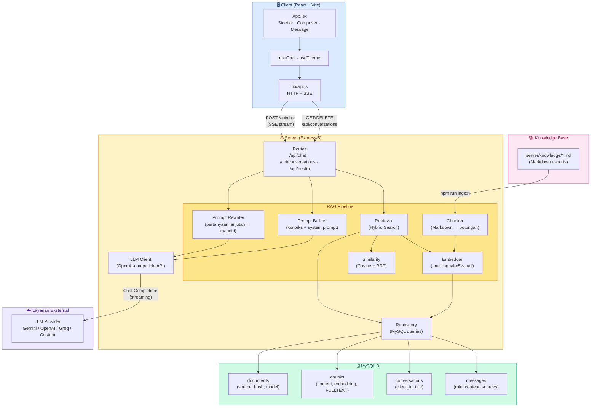
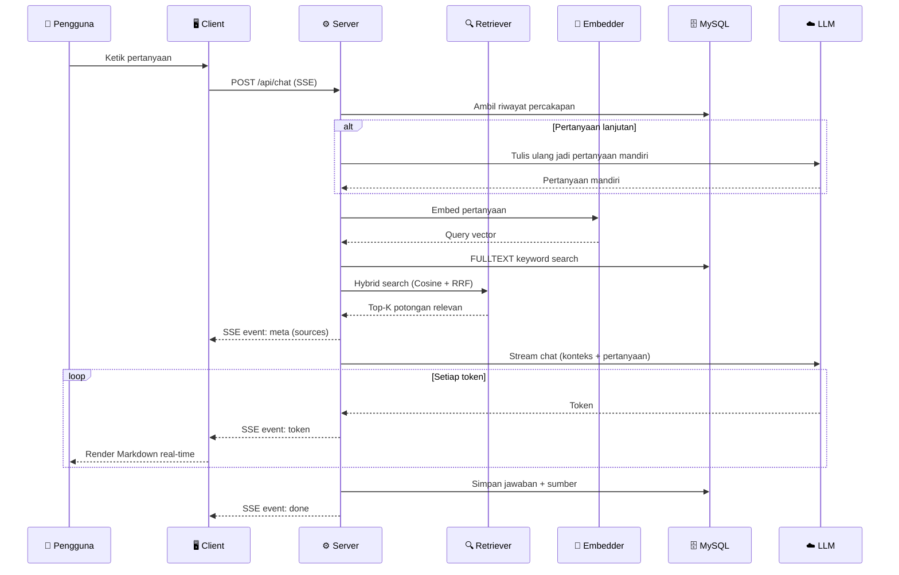
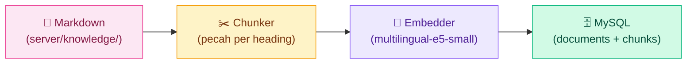

# Skie — Chatbot AI Esports (RAG)

Chatbot tanya jawab seputar dunia esports. Jawaban disusun dengan **RAG (Retrieval-Augmented Generation)**: pertanyaan dicocokkan dengan basis pengetahuan esports yang tersimpan di MySQL, lalu potongan paling relevan dikirim ke LLM sebagai konteks. Setiap jawaban menampilkan sumber yang dipakai.

| Bagian | Teknologi |
| --- | --- |
| Frontend | React 19, Vite, Tailwind CSS 4 |
| Backend | Express 5, streaming lewat Server-Sent Events |
| Database | MySQL 8 (dokumen, potongan + embedding, percakapan, pesan) |
| Embedding | Lokal di server (`Xenova/multilingual-e5-small`), tanpa API key |
| LLM | Gemini (bawaan), OpenAI, Groq, atau endpoint lain yang kompatibel dengan OpenAI |

## Menjalankan

Butuh Node.js 20+ dan MySQL 8 (atau Docker untuk menjalankan MySQL dari `docker-compose.yml`).

```bash
cp .env.example .env      # lalu isi LLM_API_KEY
npm install
npm run db:up             # MySQL lewat Docker; lewati jika memakai MySQL sendiri
npm run ingest            # membuat tabel + memasukkan basis pengetahuan
npm run dev               # server di :3001, antarmuka di http://localhost:5173
```

`npm run ingest` pertama kali mengunduh model embedding (±120 MB) ke `server/.cache`.

Untuk produksi: `npm run build && npm start`, lalu buka `http://localhost:3001` (Express ikut menyajikan hasil build frontend).

Jika memakai MySQL sendiri, buat database dan pengguna sesuai nilai `DB_*` di `.env`. Tabel dibuat otomatis oleh `npm run migrate` / `npm run ingest`.

## Mengganti penyedia LLM

Atur di `.env`, lalu jalankan ulang server. Tidak perlu ingest ulang karena embedding tidak bergantung pada LLM.

| `LLM_PROVIDER` | Yang wajib diisi | Catatan |
| --- | --- | --- |
| `gemini` (bawaan) | `LLM_API_KEY` | `LLM_MODEL` opsional untuk mengganti model bawaan |
| `openai` | `LLM_API_KEY`, `LLM_MODEL` | |
| `groq` | `LLM_API_KEY`, `LLM_MODEL` | |
| `custom` | `LLM_BASE_URL`, `LLM_MODEL` | Endpoint apa pun yang kompatibel dengan OpenAI Chat Completions, misalnya Ollama (`http://localhost:11434/v1`) |

## Menambah atau mengubah pengetahuan

Basis pengetahuan adalah berkas Markdown di `server/knowledge/`. Tambah atau sunting berkas, lalu:

```bash
npm run ingest            # hanya berkas yang berubah yang diproses ulang
npm run ingest -- --force # paksa proses ulang semuanya
```

Satu berkas = satu dokumen; judul diambil dari heading `#` pertama dan tiap bagian `##`/`###` menjadi potongan tersendiri. Isi bawaan adalah pengetahuan awal — hasil turnamen dan roster terbaru perlu diperbarui sendiri.

Jika mengganti `EMBEDDING_MODEL` atau `EMBEDDING_PROVIDER`, jalankan `npm run ingest -- --force` dan sesuaikan `RAG_MIN_SCORE` (nilai bawaan 0.81 dikalibrasi untuk model bawaan).

## Arsitektur



### Alur Data



### Alur Ingest



## Cara kerja

1. **Ingest** — Markdown dipecah per heading (maks. ±1200 karakter), tiap potongan di-embed, lalu disimpan di tabel `chunks` (embedding sebagai JSON, isi diindeks FULLTEXT).
2. **Retrieval** — pertanyaan di-embed dan dibandingkan dengan semua potongan memakai kemiripan kosinus; hasilnya digabung dengan pencarian kata kunci FULLTEXT MySQL (Reciprocal Rank Fusion). Potongan di bawah `RAG_MIN_SCORE` dibuang.
3. **Generation** — `RAG_TOP_K` potongan teratas disisipkan ke prompt. Model diminta menjawab hanya dari konteks, mencantumkan penanda sumber `[n]`, dan menolak pertanyaan di luar esports. Pertanyaan lanjutan ditulis ulang dulu menjadi pertanyaan mandiri agar pencarian tetap akurat.
4. **Riwayat** — percakapan disimpan di MySQL dan dipisahkan per browser lewat UUID di header `X-Client-Id` (tanpa login).

## API

| Metode | Path | Keterangan |
| --- | --- | --- |
| `GET` | `/api/health` | Status database, jumlah potongan, dan konfigurasi LLM |
| `POST` | `/api/chat` | Body `{ message, conversationId? }`; respons SSE: `meta`, `token`, `error`, `done` |
| `GET` | `/api/conversations` | Daftar percakapan milik klien |
| `GET` | `/api/conversations/:id` | Percakapan beserta pesannya |
| `DELETE` | `/api/conversations/:id` | Hapus percakapan |

Semua endpoint selain `/api/health` memerlukan header `X-Client-Id` berisi UUID.

## Skrip

| Perintah | Fungsi |
| --- | --- |
| `npm run dev` | Server + antarmuka dengan hot reload |
| `npm run build` / `npm start` | Build frontend / jalankan server produksi |
| `npm run db:up` / `npm run db:down` | Nyalakan / matikan MySQL Docker |
| `npm run migrate` | Buat tabel |
| `npm run ingest` | Masukkan basis pengetahuan |
| `npm test` | Uji backend (tanpa database maupun LLM) |
| `npm run lint` | ESLint untuk frontend |
